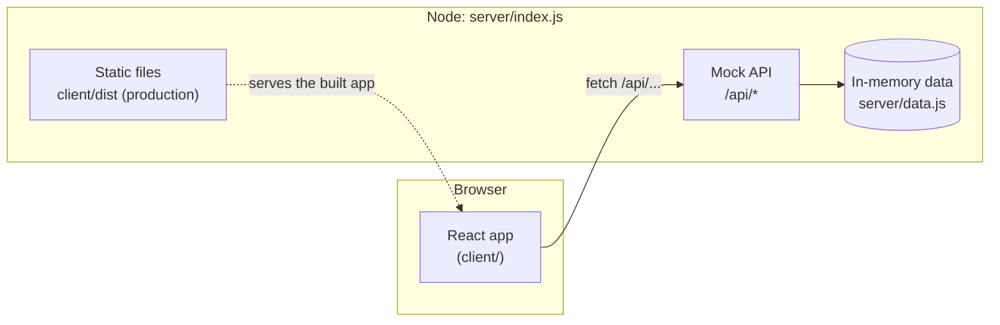
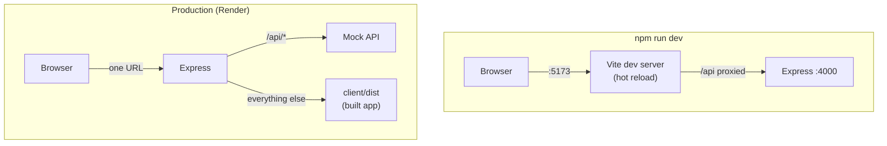
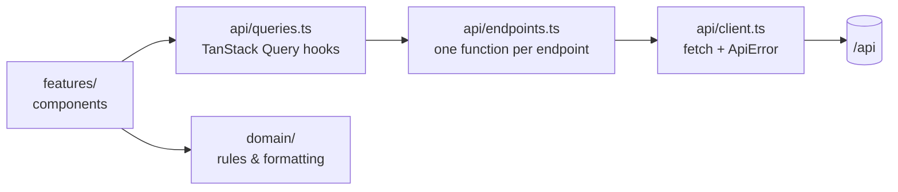
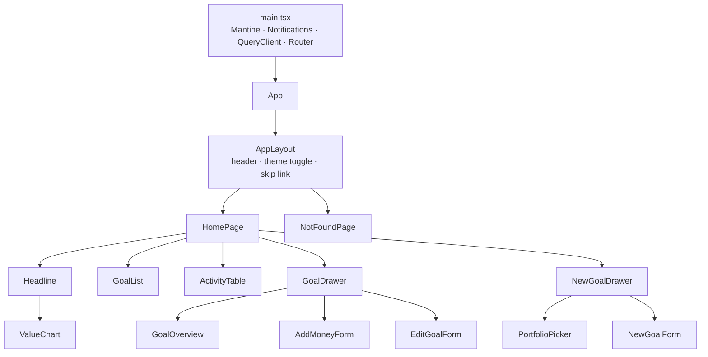
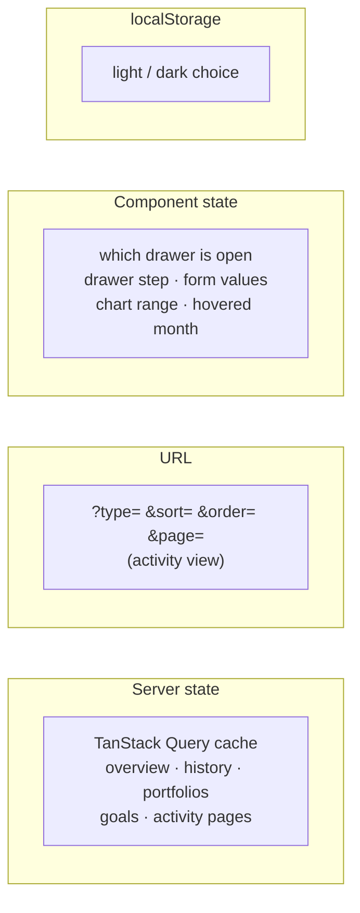
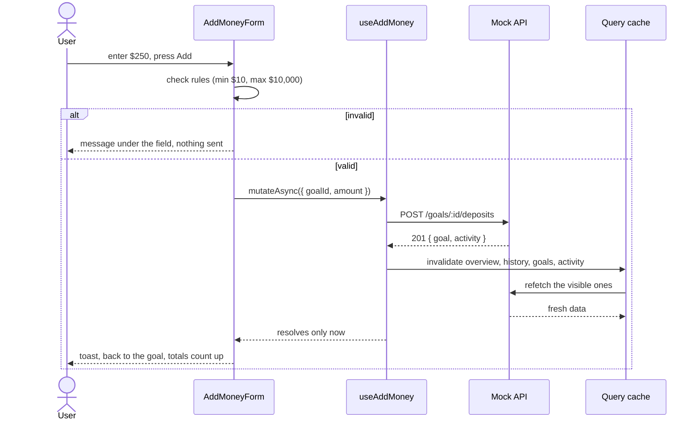
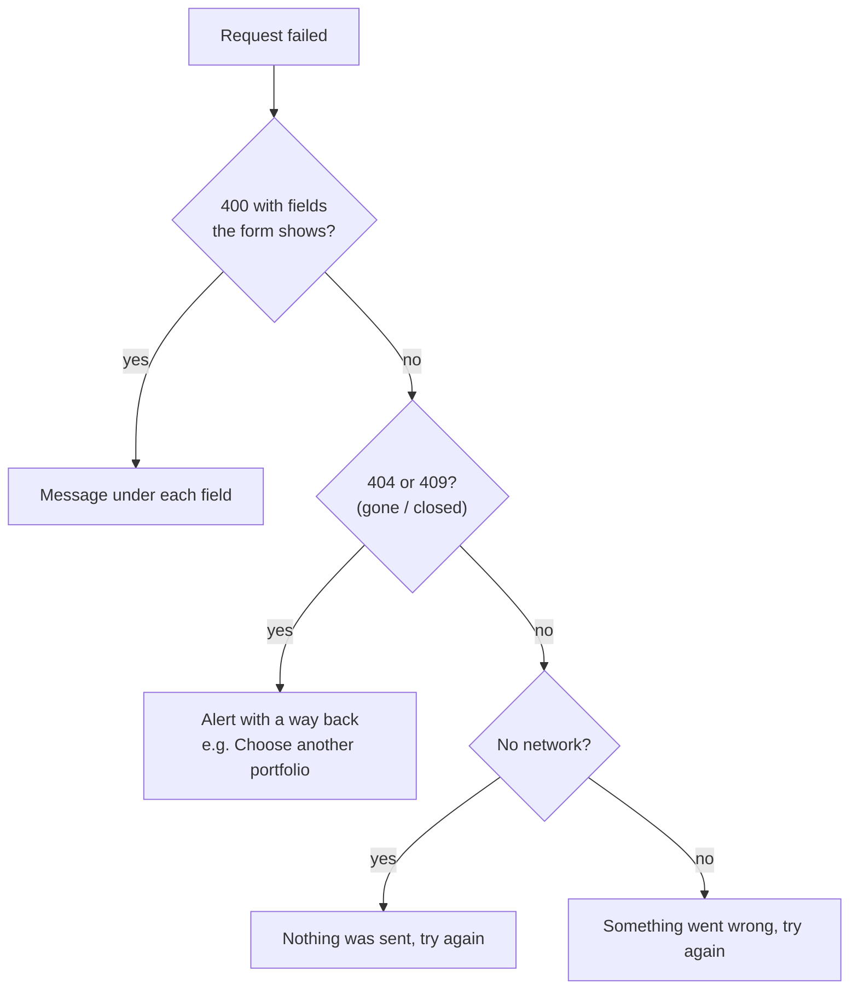
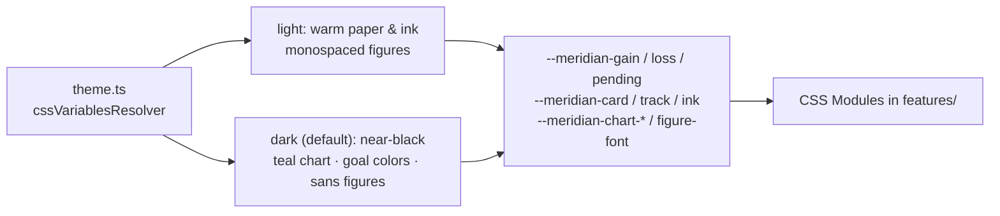
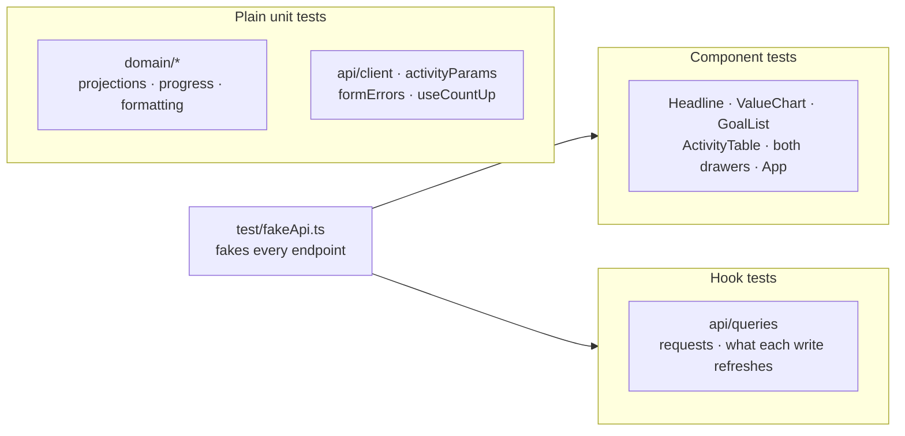

# Architecture

How Meridian is put together: what runs where, how data moves, where state
lives, and how writes and errors are handled. For the caching details see
[data-layer.md](data-layer.md); for every endpoint see [API.md](API.md).

## 1. The system

Two pieces: a React app, and a small Express server that plays the part of a
real backend.



- **The API** keeps its data in memory, seeded relative to today on start. It
  adds about 350 ms of latency to every request, so loading states are real.
- **No database, no auth.** It's a demo backend, shaped like a real one:
  validation, 400 / 404 / 409 errors, and server-side paging and sorting.

### Development vs. production

The app always calls `/api` on its own address. What answers changes:



- In **development**, Vite serves the app and proxies `/api` to Express.
- In **production**, `npm run build` compiles the app into `client/dist`, and
  Express serves it alongside the API. One service, one URL, no CORS. Any
  address that isn't an API route returns the app, which handles its own
  routing and 404 page.

## 2. The front end in layers

Each layer has one job, and data only flows one way.



| Layer | Job | Uses React? |
| --- | --- | --- |
| `features/` | Screens and components | Yes |
| `api/queries.ts` | Fetch, cache, share and refresh server data | Yes |
| `domain/` | Rules about the data: progress, projections, risk, formatting | No |
| `api/endpoints.ts` | Typed function per endpoint | No |
| `api/client.ts` | HTTP, JSON, and turning every failure into an `ApiError` | No |

Components never call `fetch` or know a URL. Business rules never touch React,
so they're tested as plain functions.

## 3. Components

One page, with two drawers on top of it.



Which data each part reads:

| Component | Hooks |
| --- | --- |
| `Headline` | `useOverview`, `useHistory` |
| `GoalList` | `useGoals`, `useOverview`, `usePortfolios` (for projections) |
| `ActivityTable` | `useActivity(filter, sort, page)` |
| `GoalDrawer` | `useGoals`, `usePortfolios`; `GoalOverview` adds `useActivity(goalId)` |
| `PortfolioPicker` | `usePortfolios` |
| Forms | `useCreateGoal`, `useAddMoney`, `useUpdateGoal` |

Each card loads and fails on its own. If the chart's request fails, the totals
and goals still show, each with its own retry.

## 4. Where state lives

Four kinds of state, each kept in the place that suits it:



- **Server data** lives only in the query cache. There's no separate store
  (Redux etc.), because there's nothing to keep that the server doesn't own.
- **The activity view** lives in the URL, so a refresh or a shared link keeps
  the filter, sort and page. Only `activityParams.ts` reads or writes it.
- **UI state** stays in the component that owns it. The drawers reset when
  they finish closing.
- **The theme choice** is saved by Mantine. A small script in `index.html`
  applies it before the first paint, so there's no flash.

## 5. A write, end to end: Add money

The same pattern is used by New goal and Edit.



The important design choice: **the write isn't "done" until the page is
right.** `onSuccess` returns the refetch promises, so the form stays in its
loading state until the fresh numbers are in the cache. When the drawer goes
back to the goal, it already shows the new value, and the count-up animates
to it. Writes are never retried automatically, since a retried deposit could
add money twice.

## 6. Errors

Every failure becomes an `ApiError` with a `status` (0 means no network) and
any per-field messages. One helper, `toFormProblem`, decides where each one
goes, for all three forms:



In every case, what the user typed stays in the form. On a 404 or 409, the
relevant list is also refetched, so the stale item disappears.

## 7. Theming

Two looks share one set of tokens. Components use `--meridian-*` variables,
never raw colors, so they follow whichever scheme is on.



Color is kept for meaning: green and red are gain and loss, and amber is
"waiting". Goal colors are identity only, shown in dark mode.

## 8. Testing



- **Vitest + React Testing Library**, about 100 tests. Elements are found by
  role and accessible name, so the tests double as an accessibility check.
- **`fakeApi.ts`** answers every GET from sample data (paging and filtering
  activity like the real server). Each test only overrides the write it's
  about.
- **Tests run as if the user prefers reduced motion,** so animations finish
  instantly. `useCountUp`'s own tests turn motion back on with a fake clock.
- **Dates are pinned** in tests that show projections or "Dec 1"-style dates.

## 9. Folder map

```
client/src/
  main.tsx, App.tsx       providers and routes
  app/                    layout, header, theme toggle
  pages/                  HomePage, NotFoundPage
  features/
    overview/             Headline, ValueChart
    goals/                GoalList, GoalDrawer (+ overview, add money, edit),
                          NewGoalDrawer (+ portfolio picker, form)
    activity/             ActivityTable, activityParams (URL state)
    shared/               RiskDots, formErrors
  api/                    client, endpoints, queries, types
  domain/                 goals.ts (rules), format.ts
  hooks/                  useCountUp
  lib/                    queryClient defaults
  theme/                  theme.ts (both schemes, tokens)
  test/                   fakeApi, factories, render helpers, setup
server/
  index.js                Express: API, validation, static app in production
  data.js                 sample data, relative to today
render.yaml               one-service deploy
```

## 10. Decisions worth knowing

| Decision | Why | Cost |
| --- | --- | --- |
| One server for API and app in production | One deploy, one URL, no CORS | The free host sleeps when idle |
| TanStack Query, no global store | Server data is the only shared state | Learning curve for newcomers |
| Activity view in the URL | Refresh and share keep the view | A small parse/write module to maintain |
| Writes resolve after the refetch | Drawers close onto correct numbers | A write takes one extra round trip |
| Hand-built SVG chart | Small, themable, keyboard-accessible; scrubbing drives the headline | Axis, scale and scrubbing logic is ours to maintain |
| Client checks repeat the server's rules | Instant feedback | Rules can drift; server errors still land in the same place |
| In-memory mock data | Zero setup to run | Shared by all visitors; resets on restart |
