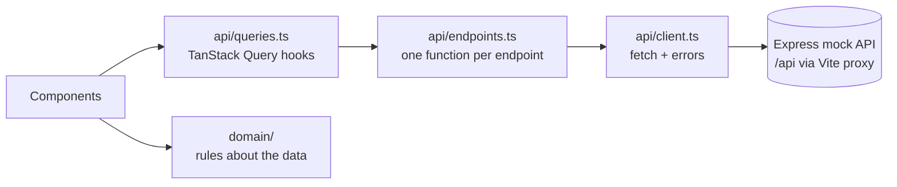

# How data flows through the app

Four small layers, each with one job. Components only ever touch the top two.



| Layer | Job | Knows about React? |
|---|---|---|
| `api/client.ts` | Make the HTTP call; turn failures into an `ApiError` with a status and field messages | No |
| `api/endpoints.ts` | One typed function per endpoint in [API.md](API.md) | No |
| `api/queries.ts` | Cache, share and refresh server data (TanStack Query) | Yes |
| `domain/` | Answer questions about the data ("has this goal started?", "when will it be reached?") | No |

---

## What TanStack Query does here

Without it, every component that needs data would write its own `useEffect` +
`fetch` + `useState` for loading and errors. TanStack Query does that once and
puts a cache in front of the API.

### 1. Each request gets a key, and the result is cached under it

```ts
queryKeys.overview                 // ['overview']
queryKeys.history                  // ['history']
queryKeys.portfolios               // ['portfolios']
queryKeys.goals.list               // ['goals', 'list']
queryKeys.activity.list(params)    // ['activity', 'list', { type: 'dividend', page: 2, ... }]
```

Components asking for the same key share one request. The goals list feeds the
goal rows and the goal drawer; portfolios feed the picker and every projection.

### 2. Loading and error states come for free

Every hook returns `{ data, isPending, isError, refetch }`. Each card renders a
skeleton, an error with a retry button, or the data. One card failing doesn't
blank the page; if the chart fails, the totals still show.

### 3. Data is reused for 30 seconds before it's refetched

`staleTime: 30_000` (in `lib/queryClient.ts`); portfolios, which rarely change,
for 5 minutes. Opening a drawer shows cached data immediately.

### 4. Paging and filtering don't flash a skeleton

`useActivity` uses `placeholderData: keepPreviousData`. Changing the filter,
sort or page keeps the current rows on screen (dimmed) while the next ones load.

### 5. Out-of-date responses are ignored

Each request gets an `AbortSignal`, so a slow response to an old filter can't
overwrite a newer one.

### 6. Each write refreshes exactly what it changed

| Write | Refreshes |
|---|---|
| `useCreateGoal` | overview, goals |
| `useUpdateGoal` | overview (monthly total), goals, activity (a rename shows there) |
| `useAddMoney` | overview, history (the chart), goals, activity |
| `useDeleteGoal`, `useRestoreGoal`, `useCloseGoal` | overview, history, goals, activity |

Each write finishes only after those refetches, so a drawer closes onto the new
numbers, and the count-up animates the total to its new value.

When a write fails because the thing is gone (404) or closed (409), the
relevant list is refetched instead, so the stale item disappears.

### 7. Retries are deliberate

- Reads retry **once**, so a blip doesn't show an error.
- Writes **never** retry automatically. A retried deposit could add money twice;
  the user retries by pressing the button again.

---

## What `domain/` does

Plain functions, no React, no fetching, each unit-tested.

| Function | Why it exists |
|---|---|
| `hasStarted(goal)` | A new goal comes back with `value: 0` and `returnPct: 0` rather than nulls. Shown as-is, that reads as "lost everything". This checks money contributed instead. |
| `progress(goal)` | Value toward target, capped at 100%, safe with a zero target. |
| `project(…)` / `projectGoal(goal, rate)` | "On track for Oct 2028": monthly deposits plus the portfolio's assumed return. Paused goals only grow; no date when there's no way to get there; stops at 50 years. Also drives "this moves your date from Oct to Sep" in Add money and Edit. |
| `riskLabel(risk)` | "Higher risk" for screen readers alongside the risk dots. |
| `crossedMilestone(before, after)` | Which milestone (25 / 50 / 75 / 100%) a deposit crossed, if any, so only real progress is celebrated. |
| `goalColor(id)` | Each goal's color, picked from its id so it doesn't change when goals are added. |
| `format.ts` | Money, signed money with a true minus ("−$9.60"), percents, and dates parsed as local calendar days so nothing shifts by a timezone. |
